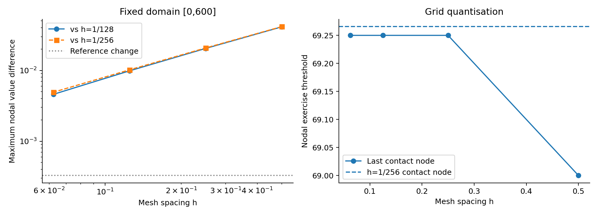
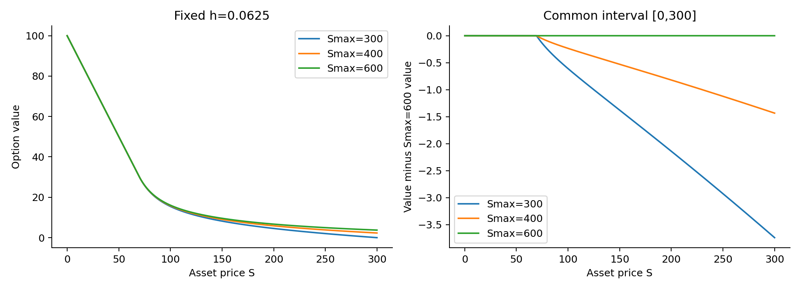

# Stage 2: local volatility and domain truncation

Status: AI-assisted draft based on executed experiments, 5 November 2026.
Independent C/E review and the course's official worksheets/audit are pending.

## Model and experiment design

We consider the perpetual American put with $K=100$, $r=0.05$, $q=0.02$ and

$$\sigma(S)=0.20\left[1+0.35\tanh\left(\frac{\log(S/100)}{0.40}\right)\right].$$

The global obstacle problem is $\min(-\mathcal LV,V-\psi)=0$, where
$\psi=(100-S)^+$ and
$\mathcal LV=\tfrac12\sigma(S)^2S^2V''+0.03SV'-0.05V$.
All experiments impose $V(0)=100$ and $V(S_{\max})=0$. No Stage 1 analytic
right boundary or closed-form value is used in Stage 2. A's monotone upwind
assembly and B's payoff-initialised policy iteration are used unchanged.
Ties select continuation. Policy iteration has no relaxation parameter.
The actual componentwise LCP residual is
$\rho=\|\min(a,b)\|_\infty$, with $a=Av-f$, $b=v-\psi$ after eliminating
the endpoints. The requested absolute tolerance is $10^{-8}$ unless stated.

To separate errors, the mesh study fixes $S_{\max}=600$ and uses
$h=0.5,0.25,0.125,0.0625$. The domain study fixes $h=0.0625$ and varies
$S_{\max}=300,400,600$. Consequently the mesh table measures approach to
a fixed truncated-domain problem, while the domain table measures sensitivity
to the artificial boundary at a fixed mesh spacing.

## Norms and exercise threshold

All comparisons use coincident nodes, selected by integer grid indices and
checked for equality. No interpolation or extrapolation is used. For error
$e_i$ on $[0,L]$, we report

$$E_\infty=\max_i|e_i|,\qquad
E_2=\left[h\left(\tfrac12 e_0^2+\sum_{i=1}^{N-1}e_i^2+
\tfrac12 e_N^2\right)\right]^{1/2}.$$

The second quantity approximates an integral L2 norm and is not RMS.
The observed order is $p=\log_2(E_h/E_{h/2})$ using the same reference.
The threshold is the last node in the contact interval connected to zero,
with $|V_i-\psi_i|\le10^{-7}$ and $S_i<K$. The artificial far endpoint
is excluded. No subgrid interpolation is applied. The next grid node is
reported as `star_upper`; this nodal transition interval is not a certified
enclosure of the continuous free boundary.

## Fixed-domain mesh refinement

The primary reference uses $h_r=1/128=0.0078125$ on $[0,600]$. The following
errors are differences to that reference sampled at the study nodes, rather
than errors to an exact Stage 2 solution.

| h | Unknowns | Maximum difference | L2 difference | Observed order | Last contact node |
| --- | --- | --- | --- | --- | --- |
| 0.5 | 1199 | 0.04121838 | 0.43034086 | — | 69.000000 |
| 0.25 | 2399 | 0.02043659 | 0.21297017 | 1.0121 | 69.250000 |
| 0.125 | 4799 | 0.00987480 | 0.10288637 | 1.0493 | 69.250000 |
| 0.0625 | 9599 | 0.00460369 | 0.04796372 | 1.1010 | 69.250000 |

The maximum difference decreases from 0.04121838 to 0.00460369. The measured
orders 1.0121, 1.0493 and 1.1010 support approximately first-order convergence,
consistent with upwind drift differencing. The mild rise above one is partly
a finite-reference effect. Using the finer $h=1/256$ reference instead gives
maximum differences 0.04154680, 0.02076502, 0.01020324 and 0.00493213,
with orders 1.0006, 1.0251 and 1.0487. These two comparisons support the same
qualitative convergence conclusion without treating either reference as exact.

The threshold remains 69.25 for the last three study levels. This plateau
is caused by nodal quantisation and does not demonstrate an exact threshold.
Both reference grids give 69.265625; the finest reference's next node is
69.26953125. On the finest study mesh the reference-node difference is
0.015625, and the nodal transition is [69.25,69.3125]. No threshold convergence
order is inferred from the plateau.

## Reference sensitivity, algebraic diagnostics and cost

The reference is refined once more to $h_r/2=1/256=0.00390625$. Comparing
the two reference solutions on the coarser reference nodes gives

$$\|V_{1/128}-V_{1/256}\|_\infty=0.0003284326202,\qquad
\|V_{1/128}-V_{1/256}\|_{2,h}=0.003422319842.$$

The maximum change is about 7.13% of the finest study-grid difference to the
primary reference. Reference uncertainty is therefore smaller than the study
error, but not negligible at the finest level. This two-grid difference is an
empirical sensitivity, not a rigorous error bound. Under an assumed first-order
asymptotic expansion, it estimates the finer reference's leading error and
twice it estimates the primary reference's leading error; that assumption has
not been independently established for these two grids alone.

| h | Iterations | Solve seconds | min a | min b | LCP residual | Met 1e-8? |
| --- | --- | --- | --- | --- | --- | --- |
| 0.5 | 62 | 0.0054 | -7.276e-12 | 0.000e+00 | 4.704e-11 | yes |
| 0.25 | 123 | 0.0150 | -2.910e-11 | 0.000e+00 | 3.872e-11 | yes |
| 0.125 | 246 | 0.0536 | -1.164e-10 | 0.000e+00 | 1.758e-10 | yes |
| 0.0625 | 492 | 0.1963 | -4.657e-10 | -9.558e-10 | 9.558e-10 | yes |
| 0.0078125 | 3935 | 11.8345 | -2.980e-08 | -2.336e-09 | 2.980e-08 | no (floor) |
| 0.00390625 | 7869 | 49.5584 | -1.192e-07 | 0.000e+00 | 1.192e-07 | no (floor) |

Here N counts mesh intervals; interior unknowns number N-1. Timings are single
solver-call measurements, excluding compression and plotting. Tridiagonal
storage is linear in N, while total work also depends on policy iterations.
The finest reference takes approximately four times as long as the primary
reference, because both the number of unknowns and the iterations roughly double.

Every study-grid solve meets the requested $10^{-8}$ tolerance. The reference
solves terminate at B's floating-point-floor condition, with actual residuals
approximately $2.98\times10^{-8}$ and $1.19\times10^{-7}$. They do not meet
the requested tolerance. Their scaled policy-system backward residuals are
approximately $1.79\times10^{-11}$ and $1.44\times10^{-10}$; these are
reported separately and are not forward solution errors.

On the finest study grid, requesting $10^{-6}$, $10^{-8}$ and $10^{-10}$
produces identical stored values (maximum difference zero). The strictest call
takes one additional iteration and stops at the floor with residual
$9.56\times10^{-10}$. Repeating the finest reference with tolerance
$10^{-10}$ also produces identical stored values and the same floor residual.
These checks show tolerance insensitivity at this precision. They do not
exclude systematic round-off error shared by both calls or certify a forward
error bound.

All runs have one contiguous contact interval, nonincreasing nodal values and
values no greater than K. The most negative payoff gap and raw second difference
across all runs are about $-2.34\times10^{-9}$, consistent with small floating-
point violations. Convexity is checked using the sign of raw second differences,
with allowance $10^{-6}$; it is not a claim that the divided second derivative
has the same tolerance. The CSV files retain all raw shape diagnostics.

## Fixed-mesh domain-truncation study

At fixed $h=0.0625$, we compare each domain with the $S_{\max}=600$ solution
on the identical nodes of [0,300]. We additionally compare on [0,200], away
from the artificial endpoint at 300. The larger-domain solution is a baseline,
not an exact infinite-domain answer.

| Smax | V(100) | V(200) | Contact node | Max difference [0,200] | Max difference [0,300] |
| --- | --- | --- | --- | --- | --- |
| 300 | 15.45604366 | 4.55200199 | 69.687500 | 2.13966887 | 3.73960665 |
| 400 | 15.83101713 | 5.87120137 | 69.437500 | 0.82046949 | 1.43361124 |
| 600 | 16.06528213 | 6.69167085 | 69.250000 | 0.00000000 | 0.00000000 |

| Smax | Iterations | Seconds | min a | min b | Residual | Contact transition |
| --- | --- | --- | --- | --- | --- | --- |
| 300 | 485 | 0.1058 | -2.328e-10 | -4.292e-11 | 2.328e-10 | [69.6875, 69.75] |
| 400 | 489 | 0.1485 | -4.657e-10 | -1.572e-10 | 4.657e-10 | [69.4375, 69.5] |
| 600 | 492 | 0.1963 | -4.657e-10 | -9.558e-10 | 9.558e-10 | [69.25, 69.3125] |

Increasing the domain raises continuation values and lowers the contact
threshold. At S=100, increasing Smax from 300 to 600 raises the value by
0.60923847; increasing it from 400 to 600 still raises it by 0.23426500.
The contact node shifts downward by 0.4375 and 0.1875 respectively relative
to those smaller domains. The maximum difference on [0,300] is 3.73960665
for Smax=300 and 1.43361124 for Smax=400. The former includes the forced zero
value at S=300; even on [0,200] the differences remain 2.13966887 and
0.82046949, so the sensitivity is not confined to the endpoint.

The price differences between domains substantially exceed the fixed-domain
mesh/reference differences, including at S=100 (see the pointwise CSV values).
The small positive signed differences, below $10^{-9}$, occur only at the
round-off scale in contact values. The numerical pattern agrees with the
prediction that a closer zero boundary depresses continuation values and
favours earlier exercise. This follows from the truncated obstacle problem;
the comparison does not establish that Smax=600 is sufficiently large for an
infinite-domain accuracy target. Further domain extension or an independently
validated asymptotic boundary treatment would be needed for that claim.

## Reproducibility and interpretation

Run `python stage2_studies.py` from the project directory. It creates a new
timestamped directory and preserves previous results. Output includes full
solution arrays, comparison tables, raw diagnostics, PNG/PDF figures, source
checksums, environment versions and pre-solve predictions followed by outcomes.
The executed source baseline is main commit
`489f549136502ff37e57a71cf2c73292f007ace3`. The environment was Python 3.12.7,
NumPy 1.26.4, SciPy 1.13.1 and Matplotlib 3.9.2. The existing 60 checks plus
four D comparison/norm checks pass (64 total).

The evidence supports approximately first-order fixed-domain value convergence,
quantised contact-node estimates and substantial domain sensitivity over the
tested truncations. Mesh difference, reference sensitivity, algebraic residual
and domain sensitivity are reported separately. Independent C/E review and the
official course protocol records remain pending; no human audit or sign-off is
asserted by these automated results.
