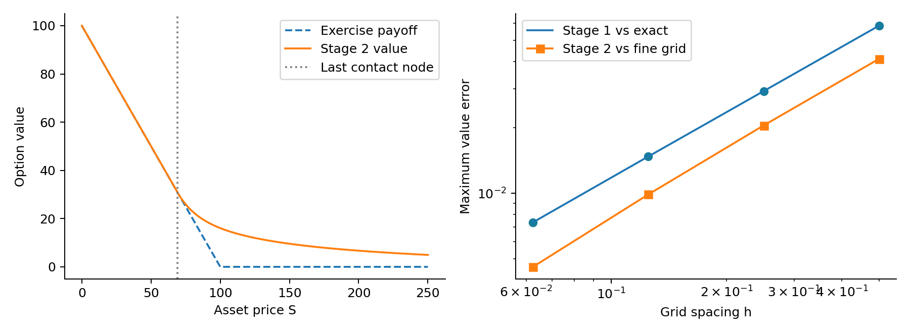
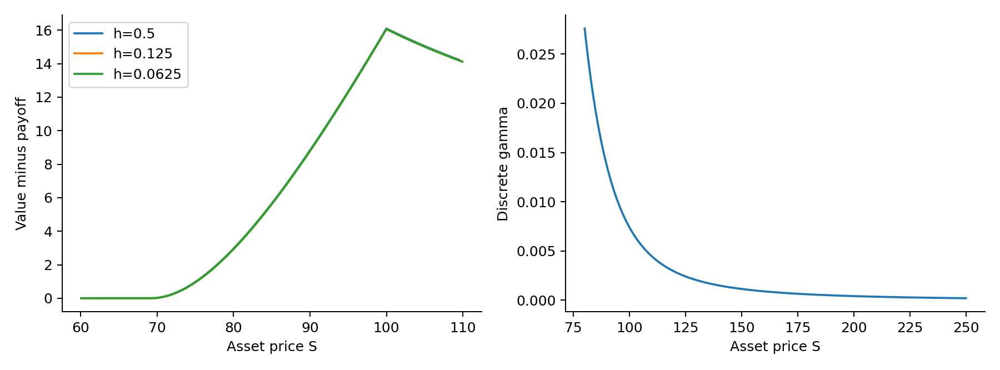
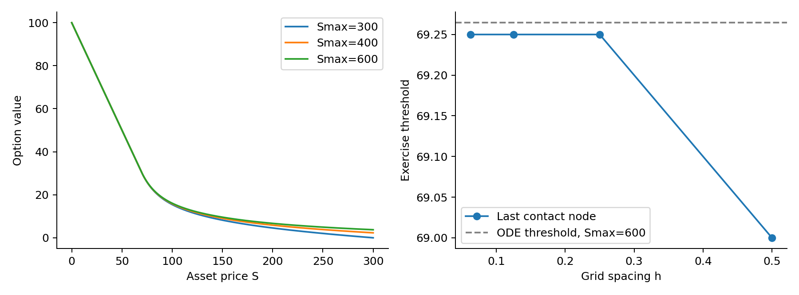

# Pricing and optimal exercise
An obstacle problem solved by monotone finite differences and policy iteration

## Abstract

This project computes the value and optimal exercise threshold of a perpetual American put. The perpetual formulation has no expiry date and therefore leads to a stationary differential inequality. Two cases are studied: a constant-volatility benchmark with a closed-form solution, and a genuinely numerical local-volatility model.

The benchmark maximum value error falls from 0.058473 to 0.007363 over four meshes, with observed order approximately one. Its finest-grid contact node is 71.4375, compared with the exact threshold 71.42857143. For the local-volatility model on [0,600], the finest study grid gives S*_h=69.2500; independent ODE shooting gives 69.26448256.

## Main finding

The central numerical finding is the separation of three error sources. Mesh refinement confirms the first-order upwind discretisation; tolerance tightening leaves the computed value unchanged; domain enlargement changes the price substantially more than the finest-grid discretisation error. Consequently, a small LCP residual does not establish infinite-domain pricing accuracy.

All tables are generated from executed code. The package contains the solver, raw results, prediction records, a custom audit, report source, and instructions for reproduction. No student names, individual contributions, or independent student verification are asserted.

# 1  The continuous problem
Risk-neutral pricing, obstacle constraints and the free boundary

Under the risk-neutral model, dS=(r-q)S dt+sigma(S)S dW. The payoff is psi(S)=max(K-S,0). The value is the supremum of the expected discounted exercise payoff over admissible stopping times. The discount rate is r>0 and the dividend yield is q>=0.

$\mathcal{L}V=\frac{1}{2}\sigma(S)^2S^2 V^{\prime\prime}+(r-q)S V^\prime-rV$
$\min\{-\mathcal{L}V,\ V-\psi\}=0,\qquad S>0$
The sign convention is -L V>=0. The value lies above the obstacle, and at each point at least one of -L V and V-psi vanishes. In the continuation region, L V=0; in the exercise region, V=psi. The obstacle is imposed throughout the contact region, rather than only at its edge.

$V(S^*)=K-S^*,\qquad V^\prime(S^*)=-1$

## Domain and boundary data

The boundary conditions are V(0)=K and V(S)->0 as S->infinity. Numerically, the latter is replaced by V(Smax)=0. The zero endpoint is fixed directly; the volatility formula is evaluated only at strictly positive interior prices, so log(0) is never formed.

Stage 1 uses K=100, r=0.05, q=0 and sigma=0.20. Substitution of V=C S^lambda into the continuation equation gives 0.5 sigma^2 lambda(lambda-1)+r lambda-r=0. The decaying root is lambda=-2.5, and smooth fit gives S*=lambda K/(lambda-1)=500/7.

$V(S)=K-S\ (S\leq S^*),\quad V(S)=(K-S^*)(S/S^*)^{-2.5}\ (S>S^*)$
Stage 2 keeps K=100 and r=0.05, sets q=0.02, and uses the positive local volatility below. Its limiting values are 0.13 as S decreases to zero and 0.27 as S increases. The spatial dependence removes the Euler-Cauchy power-law solution.

$\sigma(S)=0.20\left[1+0.35\tanh\left(\frac{\log(S/K)}{0.40}\right)\right]$

# 2  Discretisation and solution
A monotone tridiagonal LCP, not a single unconstrained linear solve

On S_i=i h, set d_i=0.5 sigma(S_i)^2 S_i^2 and b_i=(r-q)S_i. Let b_i^+=max(b_i,0), b_i^-=max(-b_i,0). The following stencil approximates -L. In particular, positive drift in L uses a forward difference for V prime in this stationary operator; its sign in -L ensures a nonpositive upper off-diagonal.

$\ell_i=-d_i/h^2-b_i^-/h,\quad u_i=-d_i/h^2-b_i^+/h$
$c_i=2d_i/h^2+|b_i|/h+r,\qquad (A V)_i=\ell_i V_{i-1}+c_i V_i+u_i V_{i+1}$
Known endpoint values are moved to the right-hand side f. Thus f_1 includes -ell_1 K, and the last entry includes -u_(N-1) V(Smax). The matrix is generally nonsymmetric. Its off-diagonals are nonpositive and its full-stencil diagonal dominance margin is r. Eliminating endpoint columns preserves strict dominance. These properties establish a nonsingular M-matrix.

$a=A V-f,\qquad g=V-\psi,\qquad \min(a,g)=0$

## Iteration and stopping

Policy iteration starts from V=psi. At each interior node, choose exercise when g_i<a_i, otherwise choose continuation. Exercise rows are replaced by V_i=psi_i; continuation rows retain the PDE stencil. Each policy system is solved by a banded direct solver. Exact ties choose continuation, which avoids unnecessary propagation through the initial zero-payoff tail.

The stopping criterion is max_i |min(a_i,g_i)|<=tol. If the policy repeats before the requested tolerance is reached, the code records a floating-point floor and reports the actual defect; it does not label the requested tolerance as achieved. Iteration counts and both raw complementarity and scaled policy-system backward residuals are retained.

For a hand check, S=100, h=1, sigma=0.20, r=0.05 and q=0 give the row (-200, 405.05, -205). The implementation checks this independently. Diffusion is centred but drift is first order, so first-order global value convergence is the stated expectation.

## Independent ODE shooting

The independent reference solves L w=0 backwards from w(Smax)=0 and w prime(Smax)=-1. The root of w(s)+(K-s)w prime(s)=0 determines the boundary; scaling by -1/w prime(s) enforces value matching and smooth fit. ODE integration uses rtol=2e-11, atol=1e-12, maximum step 1, and root tolerance 1e-11. This shares no FDM matrix or policy iteration.

# 3  Exact-solution validation
Stage 1: fixed Smax=400 with exact upper endpoint data

The exact value at Smax is imposed in this experiment. This deliberately removes far-field truncation error from the benchmark; the zero-boundary domain study is performed separately in Stage 2. The maximum error includes every grid node. The discrete L2 norm is sqrt(h sum_i e_i^2); endpoint errors vanish in this validation setup.

| h | Max error | L2 error | Order | Contact node | Boundary error |
| --- | --- | --- | --- | --- | --- |
| 0.5 | 5.847e-02 | 4.960e-01 | - | 71.5000 | 7.143e-02 |
| 0.25 | 2.935e-02 | 2.487e-01 | 0.995 | 71.2500 | 1.786e-01 |
| 0.125 | 1.473e-02 | 1.248e-01 | 0.994 | 71.3750 | 5.357e-02 |
| 0.0625 | 7.363e-03 | 6.235e-02 | 1.001 | 71.4375 | 8.929e-03 |

The value error approximately halves at each refinement. This agrees with the expected first-order effect of drift upwinding. The nodal threshold error is not monotone: halving h can move the last contact node from one side of the continuous threshold to the other. A price convergence rate cannot therefore be assigned automatically to each boundary-error pair.

| h | Iterations | LCP residual | Backward residual | Smooth-fit defect |
| --- | --- | --- | --- | --- |
| 0.5 | 57 | 2.111e-11 | 1.649e-13 | 4.541e-02 |
| 0.25 | 115 | 4.858e-11 | 3.781e-13 | 1.287e-02 |
| 0.125 | 229 | 2.915e-11 | 2.268e-13 | 8.197e-03 |
| 0.0625 | 457 | 1.164e-10 | 4.987e-13 | 5.850e-03 |

## Threshold and smooth fit

The numerical boundary is the last node in the contiguous contact set with V_i-psi_i<=1e-7 and S_i<K. No interpolation is used. The next node is recorded for reproducibility, but these two nodes are not asserted to bracket the continuous boundary. The S<K restriction prevents the artificial zero far-field endpoint from being mistaken for exercise.

Smooth fit is assessed from the first difference between the first two continuation nodes: |(V_(k+2)-V_(k+1))/h+1|. Its decreasing defect is supporting evidence. The full exact value error and exact threshold comparison remain the primary validation tests.

# 4  Local-volatility experiment
Stage 2: grid refinement on the fixed domain [0,600]

The primary reference is the same monotone LCP solved with h=1/128. A second reference with h=1/256 checks its remaining bias. All coarser meshes nest in the reference grid, so errors are evaluated by direct subsampling without interpolation.

| h | Max vs grid ref | Order | Max vs ODE | Contact node |
| --- | --- | --- | --- | --- |
| 0.5 | 4.122e-02 | - | 4.188e-02 | 69.0000 |
| 0.25 | 2.044e-02 | 1.012 | 2.109e-02 | 69.2500 |
| 0.125 | 9.875e-03 | 1.049 | 1.053e-02 | 69.2500 |
| 0.0625 | 4.604e-03 | 1.101 | 5.260e-03 | 69.2500 |

The reference-to-reference maximum difference is 3.284e-04. The h=1/128 reference differs from the independent ODE solution by 6.568e-04; the h=1/256 result differs by 3.284e-04. Thus the reference is not exact. Subtracting its nonzero first-order error slightly inflates the finest pairwise rates above one.

## Independent continuous reference

The independent fixed-domain threshold is 69.26448256. The h=0.0625 last contact node is 69.2500, while both fine reference grids report 69.265625. Identical nodal thresholds on two meshes do not imply that the continuous threshold has been computed exactly.

# 5  Far-field truncation matters
The h study and Smax study answer different questions

At fixed h=0.0625, increasing Smax moves the artificial zero value further into the tail. Compare prices at common asset values, rather than conflating a changing domain with a changing mesh. The price increases and the exercise threshold decreases.

| Smax | Vh(100) | Vh(200) | Contact node | ODE V(100) |
| --- | --- | --- | --- | --- |
| 300 | 15.456044 | 4.552002 | 69.6875 | 15.451228 |
| 400 | 15.831017 | 5.871201 | 69.4375 | 15.825975 |
| 600 | 16.065282 | 6.691671 | 69.2500 | 16.060076 |

The difference between Smax=400 and 600 at S=100 is about 0.2343, compared with a Stage 2 finest-study maximum grid error of about 0.0046 against the fine-grid reference. Truncation sensitivity therefore dominates this mesh error. The results on [0,600] should be interpreted as finite-domain results, not a certified infinite-domain price.

| ODE domain Smax | Continuous threshold | Continuous V(100) |
| --- | --- | --- |
| 600 | 69.26448256 | 16.06007591 |
| 1200 | 69.18555705 | 16.17703654 |
| 2400 | 69.17017934 | 16.19989806 |

The ODE extension confirms remaining tail sensitivity. Consecutive domain agreement is not a rigorous error bound; improved asymptotic boundary data would be a useful extension.

# 6  Verification and solver error
Evidence beyond a small residual

For every reported mesh, results/all_diagnostics.csv includes min(a), min(g), max|min(a,g)|, the scaled policy residual, matrix signs, option bounds, first differences, second differences, and contact-set connectivity. The option is decreasing and convex within floating-point tolerance and remains between payoff and K. Tiny negative second differences near flat contact rows are reported rather than suppressed.

| Requested tol | Iterations | Actual LCP residual | Price change |
| --- | --- | --- | --- |
| 1.000e-04 | 246 | 1.758e-10 | 0.000e+00 |
| 1.000e-06 | 246 | 1.758e-10 | 0.000e+00 |
| 1.000e-08 | 246 | 1.758e-10 | 0.000e+00 |
| 1.000e-10 | 247 | 1.758e-10 | 0.000e+00 |

The tolerance experiment uses h=0.125 and Smax=600. Tightening the requested residual threshold leaves the computed vector unchanged. At 1e-10, a repeated policy identifies a floating-point floor: the requested tolerance is not achieved. Actual residuals and that status are both recorded in the CSV; this is not hidden as convergence.

The backward residual divides each policy-row residual by its absolute row sum times ||V||inf plus the absolute right-hand side, with a denominator floor of one. A backward residual alone is not a forward error bound. Here the independent ODE comparison and unchanged solution under tighter policy stopping rules provide the additional evidence that algebraic error is negligible at the reported study meshes.

## Audit and prediction record

Contact tolerances 1e-9, 1e-7 and 1e-5 all return the same finest-study contact node. The custom audit also checks the hand-derived stencil, matrix action, and exhaustive enumeration of all active-set policies on a five-unknown problem. Every feasible candidate agrees with policy iteration.

Predictions are timestamped immediately before the final recorded experiments and reconciled in protocols/reconciliation.md. They are AI-authored records. The original course five-gate and prediction worksheet templates were not available; the custom audit is not a claim that the official forms or independent student sign-off have been completed.

# 7  Interpretation and reproduction
Scope, limitations and the complete computational record

## Conclusions

Monotone finite differences and policy iteration solve the obstacle constraints reliably. Stage 1 validates prices and the free boundary against an analytic solution. Stage 2 confirms convergence toward an independently computed finite-domain solution. The main practical limitation is the imposed far-field boundary, rather than the LCP stopping tolerance.

## Limits of the results

This is a one-dimensional stationary obstacle problem. It is neither a finite-maturity time-dependent American option nor the optional Poisson exercise model. The upwind method is deliberately first order; the report makes no second-order claim. No uncertain infinite-domain digits are presented as established results. Runtime is machine dependent and is recorded separately from accuracy.

## Reproduce the package

From the project directory, install the listed dependencies and run: python run_project.py, followed by python build_report.py. The first command regenerates all tables, figures, prediction logs and audit checks; the second reads the recorded summary and regenerates this PDF and its editable Markdown manuscript. The finer reference is intentionally more expensive than the four study meshes.

| File / directory | Purpose |
| --- | --- |
| solver.py | LCP assembly, policy iteration, independent ODE |
| run_project.py | Experiments, assertions, tables and figures |
| build_report.py | PDF and manuscript from recorded values |
| results/ | CSV tables, JSON, solution arrays and run log |
| figures/ | PNG and vector PDF figures |
| protocols/ | Predictions, reconciliation, AI audit and disclosure |
| README.md | Setup, run instructions and result guide |

## Source and computational environment

Problem data and required experiments follow the supplied Problem Pack, Directions for the PDE BVP Project (Weeks 5-9), open direction 5.3, "Perpetual American put (obstacle/free-boundary BVP)", pages 8-9, and the standing protocols on page 10. The analytic derivation and difference stencil are written explicitly in this report. NumPy, SciPy and Matplotlib versions and the execution platform are recorded in results/summary.json.
